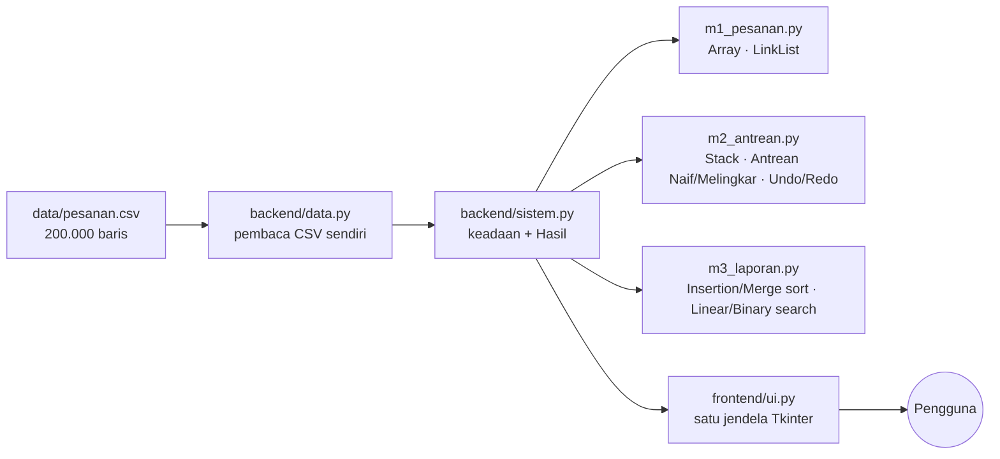
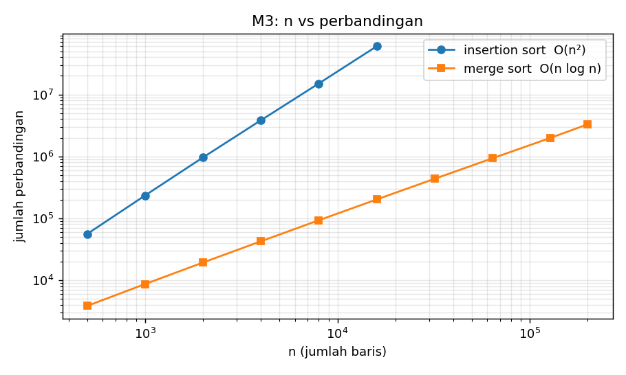

# Aplikasi Pesan Antar

Engine backend layanan antar makanan versi mini (proyek "2EZ4U APP"). Proyek Akhir **Struktur Data & Analisa Algoritma (EC234303)**, Departemen Teknik Komputer FTEIC-ITS.
Python 3.11+, tanpa dependensi luar (hanya `tkinter` bawaan Python untuk UI).

Status: **M1, M2, M3 selesai** (M4–M6 belum; berkasnya masih kerangka kosong).

## Cara menjalankan

```bash
python app.py                                  # buka jendela Tkinter, klik menu "Load" lebih dulu
python -m unittest discover -s tests -t .      # 30 tes (M1, M2, M3, integrasi)
python bench_m3.py                             # membuat tabel n vs perbandingan + grafik
```

## Arsitektur



Setiap menu di UI memanggil satu metode `Sistem`, yang mengukur waktu dan mengembalikan objek `Hasil`
(ringkasan, tabel, catatan, modul, ms). Panel **COMMAND** mencatat tiap perintah beserta modul dan waktunya.

## Kepatuhan aturan main

Tanpa `dict`, `set`, `sorted`, `.sort()`, `heapq`, `bisect`, `collections`, literal `{}` maupun comprehension dict/set.
`list` hanya dipakai sebagai petak memori primitif (`[None] * kapasitas`); `Array` memiliki
logika tumbuh 2x, geser, dan hapus sendiri. CSV dibaca dengan pemecah baris buatan sendiri (nama seperti
`"Oskar Puspita, S.Sos"` memuat koma di dalam tanda kutip).

## M1 — Array vs Linked List

| Operasi | Array | Linked List |
|---|---|---|
| Lihat ke-i | O(1) | O(n) telusur i simpul |
| Tambah REGULER (belakang) | O(1) amortized | O(1) (pointer `tail`) |
| Tambah PRIORITAS (indeks n/2) | O(n) geser | O(n) telusur |
| Tambah VIP (indeks 0) | O(n) geser | O(1) |
| Hapus ke-i | O(n) geser | O(n) telusur |

Array tumbuh **2x** saat penuh (kapasitas awal 4); memuat 200.000 baris hanya menyalin ~262 ribu elemen total.
Setiap hasil menampilkan jumlah elemen digeser / simpul ditelusuri, bukan hanya waktu.

## M2 — Stack & Queue

* **Kasir**: `pecah_token` (12000 = satu token, angka negatif literal didukung) → `ke_postfix` (stack operator) → `hitung`
  (stack angka; pop pertama = operand **kanan**). Tiap langkah muncul sebagai tabel 1.x (konversi) dan 2.x (evaluasi).
  Galat (kurung tak berpasangan, bagi nol, operand kurang) ditampilkan sebagai pesan, bukan crash.
* **Antrean Naif**: di atas `Array`, dequeue = ambil indeks 0 lalu geser sisa (jumlah geseran dihitung).
* **Antrean Melingkar**: `data, front, rear, count`, geser dengan `(i+1) % K`.
  Keputusan yang didokumentasikan: **pencacah `count`** membedakan kosong vs penuh; saat **penuh, enqueue menumbuhkan
  kapasitas 2x** (salin berurutan dari `front`, lalu `front=0`); dequeue saat kosong mengembalikan `None`.
* **Undo/Redo** (dua stack): catatan `("ENQUEUE", pesanan)` dan `("DEQUEUE", versi, daftar_pesanan)` (daftar disimpan penuh,
  bukan hitungannya). Undo = kebalikan aksi; redo = aksi **asli**; aksi baru **mengosongkan redo**.
  Undo DEQUEUE mengembalikan seluruh daftar ke **depan** antrean, urutan asli terjaga.

Contoh keluaran pada 200.000 baris (19.850 pesanan ANTRE; angka waktu bergantung mesin):

| Perintah | Elemen digeser | Catatan |
|---|---|---|
| dequeue naif x1 | 19.850 | O(n) per dequeue |
| dequeue circular x1 | 0 | hanya `front` maju |
| dequeue naif x100 | 1.979.950 | persis sama dengan acuan |
| dequeue circular x100 | 0 | |

## M3 — Sort & Search

Setiap menu melaporkan **jumlah perbandingan** (dan pemindahan) lewat pencacah `Hitung` yang dititipkan ke algoritma.

* `insertion_sort` — di tempat, **stabil** (menggeser hanya bila `K[j] > kunci`), O(n²). Menu menolak > 20.000 baris dengan pesan.
* `merge_sort` — bottom-up, **stabil** (`<=`, kiri didahulukan), sisa kiri/kanan selalu disalin, O(n log n).
* `linear_search` — O(n); tidak butuh data terurut.
* `binary_search` — O(log n), `lo <= hi`; **butuh daftar terurut menurut kunci yang dicari**. Karena laporan terurut
  menurut waktu selesai, pencarian oid memakai daftar terpisah yang diurutkan menurut oid (dibangun **sekali** dengan merge sort,
  ongkosnya dicatat di panel COMMAND, dan dibuang bila Array M1 berubah).
* Kunci pengurutan: `oid`, `harga`, `selesai` (selesai kosong dianggap paling akhir).

### Tabel n vs perbandingan (kunci harga, `python bench_m3.py`)

| n | insertion: perbandingan | insertion: ms | merge: perbandingan | merge: ms | rasio perb. (ins/merge) |
|---:|---:|---:|---:|---:|---:|
| 500 | 55.847 | 4,88 | 3.834 | 0,47 | 14,6x |
| 1.000 | 233.802 | 22,96 | 8.651 | 1,18 | 27,0x |
| 2.000 | 962.430 | 98,38 | 19.269 | 2,30 | 49,9x |
| 4.000 | 3.831.520 | 397,68 | 42.417 | 6,18 | 90,3x |
| 8.000 | 15.058.881 | 1807,52 | 92.702 | 12,66 | 162,4x |
| 16.000 | 60.049.240 | 8309,19 | 201.104 | 44,35 | 298,6x |
| 32.000 | (ditolak, > 20.000) | - | 433.728 | 66,33 | - |
| 64.000 | (ditolak, > 20.000) | - | 930.129 | 144,33 | - |
| 128.000 | (ditolak, > 20.000) | - | 1.985.995 | 433,45 | - |
| 200.000 | (ditolak, > 20.000) | - | 3.290.117 | 732,61 | - |



Lipat dua n → perbandingan insertion sort ≈ **4x** (kuadratik), merge sort ≈ **2x** (n log n).
Pada n=2.000 dan 4.000, perbandingan insertion sort (962.430 dan 3.831.520) sama persis dengan angka implementasi acuan di soal.

### Alasan memilih algoritma
* Insertion sort: sederhana, cocok untuk data kecil / hampir terurut; dipakai sebagai pembanding agar O(n²) terlihat nyata.
* Merge sort: satu-satunya yang layak untuk 200.000 baris, stabil sehingga pesanan dengan kunci sama tetap berurutan masuk.
* Linear search: tepat bila hanya mencari sekali-dua kali (tanpa biaya pengurutan).
* Binary search: untung bila daftar terurut dicari berkali-kali; biaya pengurutan dibayar sekali.

## Catatan & batasan

* Pada menu insertion sort mendekati batas 20.000 baris, jendela dapat terasa diam beberapa belas detik (Python murni); angka wajar karena memang O(n²).
* Dequeue naif dibatasi 1.000 per perintah agar jendela tidak membeku.
* Menu ARRAY dan LINKEDLIST masing-masing mengubah strukturnya sendiri, sehingga isinya bisa berbeda setelah penambahan/penghapusan.
  Pencarian & pengurutan M3 memakai isi Array M1.
* Tabel di UI menampilkan paling banyak 100 baris agar tetap responsif.
* Catatan undo untuk aksi M1 (`ORDER`) belum disambungkan; undo/redo mencakup ENQUEUE dan DEQUEUE.

## Struktur repositori

```
aplikasi-pesan-antar/
├── README.md   app.py   bench_m3.py
├── data/       pesanan.csv  peta.csv
├── backend/    util.py  data.py  sistem.py
│               m1_pesanan.py  m2_antrean.py  m3_laporan.py   (m4–m6: kerangka)
├── frontend/   ui.py
├── tests/      test_m1.py  test_m2.py  test_m3.py  test_sistem.py
└── docs/       m3_grafik.png  bench_m3.md  (+ screenshot/)
```

## Screenshot & video demo

> **TODO sebelum submit** (butuh jendela Tkinter nyata): tambahkan tangkapan layar tiap menu M1–M3 ke `docs/screenshot/`
> dan tautan video demo di bawah ini.
>
> Video demo: _(tempel tautan di sini)_
